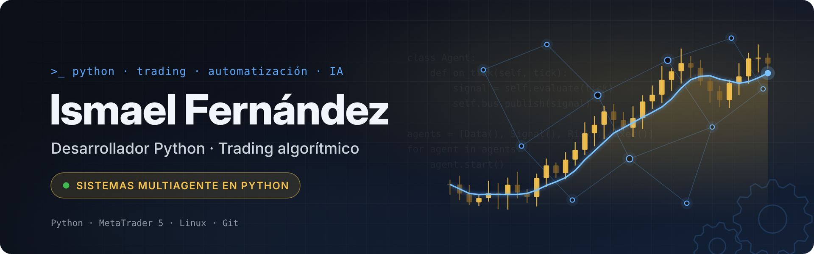

  

  

  
  

---

Programo en Python y me interesa sobre todo la automatización y el trading algorítmico.

Antes de dedicarme a esto trabajé diez años como masajista. Ahora estoy haciendo un cambio completo hacia la programación: estoy cursando la formación de desarrollo Full Stack en ConquerBlocks y, en paralelo, aprendo por mi cuenta construyendo herramientas y scripts desde cero. Le doy mucha importancia a la parte que no se ve: cómo está organizado el código, qué responsabilidad tiene cada pieza y cómo encaja todo usando programación orientada a objetos.

Estoy abierto a prácticas o a un primer puesto como desarrollador junior.

## 📌 Proyectos

**Bot de trading algorítmico** *(repositorio privado)*
Bot de trading escrito en Python e integrado con MetaTrader 5. En vez de un único script que lo haga todo, está diseñado como un sistema multiagente en el que cada componente tiene una función concreta y se coordina con los demás. Ahora mismo está en forward test en cuenta demo, funcionando en un VPS con Windows.

El código es privado, pero si te interesa puedo explicarte su arquitectura en una entrevista.

*Iré añadiendo aquí nuevos proyectos.*

## 💻 Tecnologías y Herramientas

  
  
  
  
  
  
  
  

- **Lenguaje:** Python (programación orientada a objetos)
- **Trading:** MetaTrader 5 (API de Python)
- **Entorno de trabajo:** Linux / WSL (Ubuntu), Visual Studio Code, terminal personalizada
- **Entornos virtuales:** virtualenv, Conda
- **Control de versiones:** Git, GitHub
- **Infraestructura:** VPS con Windows

## ⚙️ Cómo trabajo

Me gusta tener el código bien separado por responsabilidades, revisar cada cambio antes de llevarlo a producción y probar en demo todo lo que pueda antes de arriesgar nada real. Prefiero ir despacio y entender por qué funciona algo a que funcione de casualidad.

## 📫 Contacto

Si te interesa algo de lo que hago o quieres comentar una idea, escríbeme.
